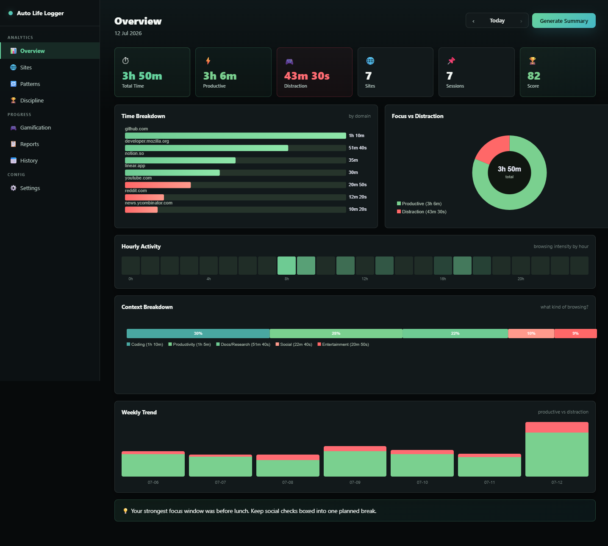
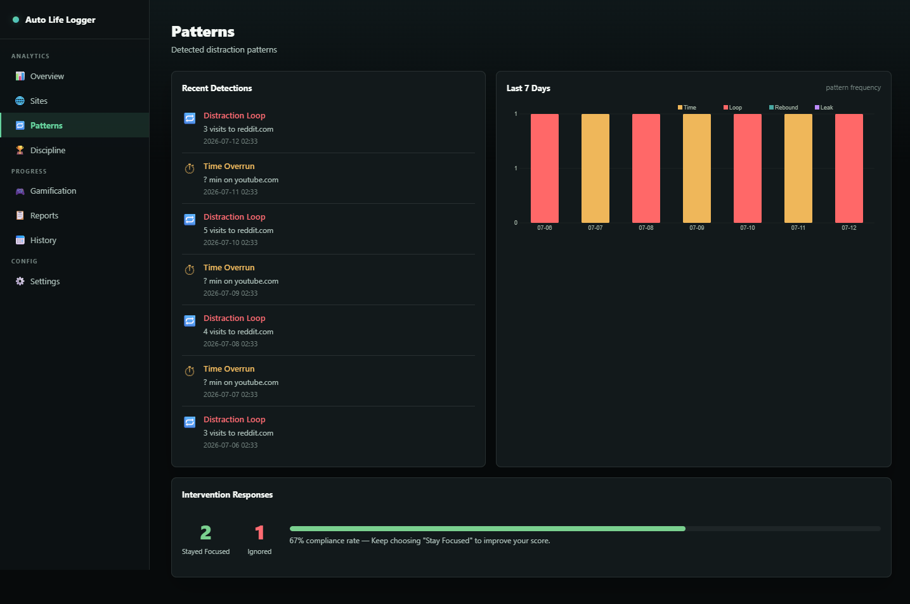
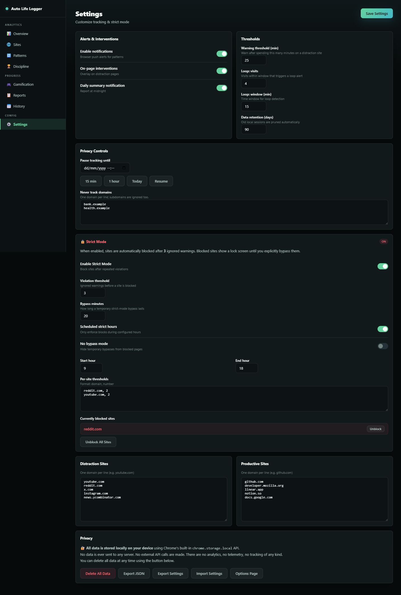

# Auto Life Logger

A privacy-focused Chrome extension (Manifest V3) for tracking browsing habits, analyzing focus patterns, computing daily discipline scores, and preventing distraction loops with custom intervention quotas.


## Overview

**Auto Life Logger** is a local-first productivity and habit-tracking browser extension built for Chrome. It monitors active tab durations, classifies visited domains into distinct productivity tiers (Work, Learning, Social, Distraction), and calculates an objective daily discipline score without transmitting data over the network.

Users can set custom daily domain quotas, trigger soft-break reminders or distraction overlays, and analyze hour-by-hour browsing distribution on an interactive full-page dashboard.

## Features

- **Local-First Architecture**: All timestamps, session lengths, and habit metrics remain strictly inside `chrome.storage.local` with zero external tracking servers.
- **Automated Activity & Category Logging**: Classifies web domains in real time using background service worker alarms and tab navigation lifecycle listeners.
- **Daily Discipline Scoring**: Computes daily focus efficiency scores based on productive versus distracted browsing ratios, tracking consistency streaks over time.
- **Focus Interventions & Quotas**: Configurable daily domain time limits with customizable gentle nudge banners or distraction blockers.
- **Interactive Full-Page Dashboard**: Visualizes hour-by-hour browsing trends, category distributions, and top visited sites using responsive HTML5 canvas charts.
- **Data Portability**: Full JSON export and import capabilities for offline data analysis and local backup restoration.
- **Automated Testing**: Test pipeline with Node.js unit tests, Chrome API smoke scripts, and Playwright UI validation.

## Screenshots

| Analytics Dashboard | Discipline Score & Categories | Quota Interventions & Settings |
|:---:|:---:|:---:|
|  |  |  |

## Tech Stack

- **Platform**: Chrome Extension Manifest V3 (Chrome 116+)
- **Core Extension Engine**: Vanilla JavaScript (ES Modules, Service Worker `background.js`, Content Scripts `blocker.js`, `content.js`)
- **Browser APIs**: `chrome.storage.local`, `chrome.alarms`, `chrome.notifications`, `chrome.idle`
- **Frontend Views**: HTML5, CSS Grid & Flexbox, HTML5 Canvas API
- **Testing & Quality**: Playwright, Node.js Test Runner, Chrome API validation scripts

## Project Structure

```text
auto-life-logger/
├── icons/                      # Extension icons (16x16, 32x32, 48x48, 128x128)
├── scripts/                    # Smoke testing and manifest validation tools
│   ├── smoke-chrome.js         # Headless Chrome extension launcher
│   └── validate-extension.js   # Manifest and permission integrity validator
├── store-assets/               # Web store marketing banners, promotional tiles, and preview HTML
├── tests/                      # Automated unit and Playwright integration tests
│   ├── background-clear-data.test.js # Background data clearing tests
│   └── ui-smoke.spec.js        # Playwright browser dashboard tests
├── _final_desktop_screenshots/ # Production desktop screenshot captures
├── background.js               # Service worker for alarm scheduling and tab tracking
├── blocker.js                  # Document-start content script for domain interventions
├── content.js                  # Idle and visibility state detector
├── dashboard.html / .js        # Main full-page metrics & analytics dashboard
├── manifest.json               # Manifest V3 configuration & permission definitions
├── onboarding.html / .js       # First-install welcome & permission setup page
├── options.html / .js          # Extension settings & domain category configuration
├── package.json                # Development dependencies and test runners
└── popup.html / .js            # Quick browser action toolbar popup
```

## Installation

### Load into Google Chrome

1. Clone or download the repository:
   ```bash
   git clone https://github.com/flegardev/auto-life-logger.git
   cd auto-life-logger
   ```

2. Open Google Chrome and navigate to `chrome://extensions/`.
3. Enable **Developer mode** via the toggle in the top-right corner.
4. Click **Load unpacked** and select the `auto-life-logger` root directory.
5. The extension icon will appear in your Chrome toolbar.

### Development & Test Setup

To run automated tests and validation scripts:

1. Install development dependencies:
   ```bash
   npm install
   ```

2. Run test suites:
   ```bash
   # Run all validation and unit test suites
   npm test

   # Run Node unit tests
   npm run test:unit

   # Run Chrome extension API smoke tests
   npm run test:chrome

   # Run Playwright UI tests
   npm run test:ui
   ```

## Configuration

Auto Life Logger requires **no external API keys or server configuration**.

All settings (such as custom category mappings, daily time limits, and notification preferences) are configured directly in the browser via the **Options** page (`options.html`) or the **Dashboard** (`dashboard.html`).

## Available Scripts

| Command | Description |
|---|---|
| `npm test` | Runs unit tests, Chrome smoke tests, and Playwright UI tests |
| `npm run test:unit` | Runs isolated state and calculation tests with Node.js test runner |
| `npm run test:chrome` | Validates extension loading and permissions in headless Chrome |
| `npm run test:ui` | Executes Playwright end-to-end dashboard interaction tests |
| `npm run lint` | Runs manifest and script syntax validation checks |

## License & Portfolio Notice

Copyright (c) 2026 Tini Flegar. All rights reserved.
Published for portfolio inspection and technical demonstration.
