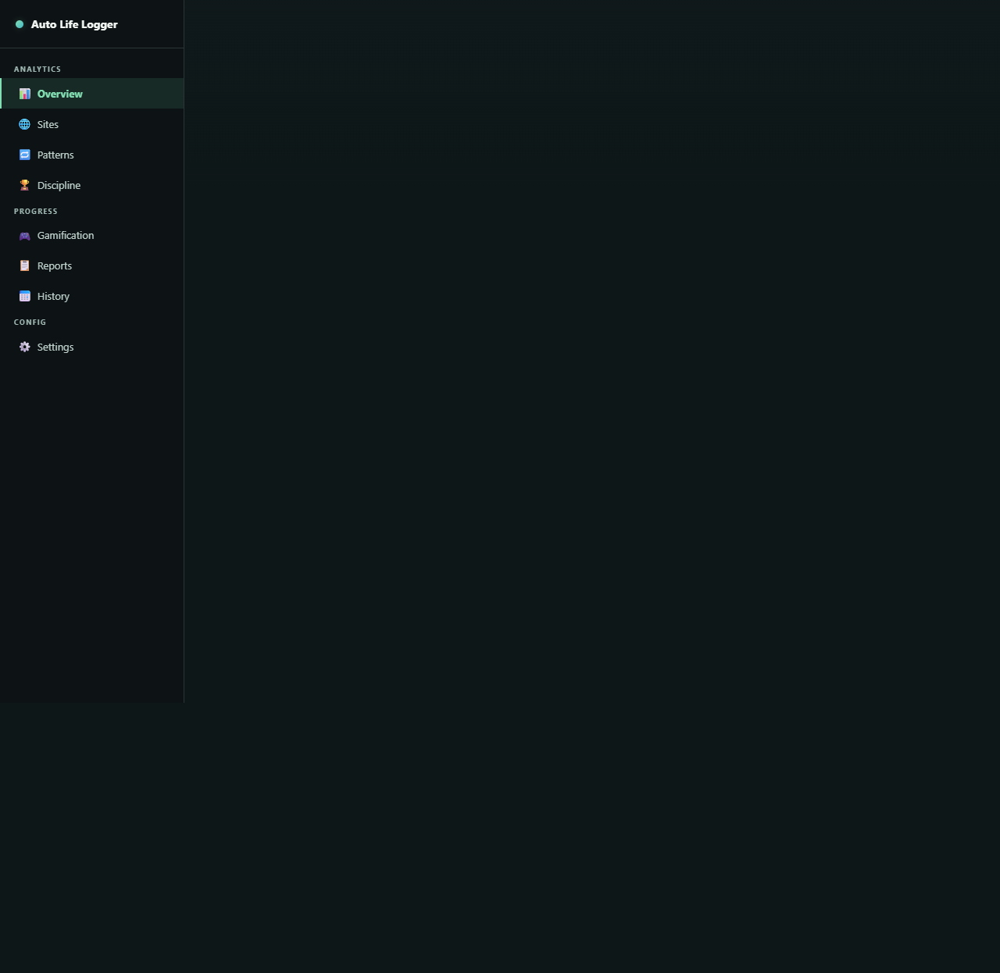
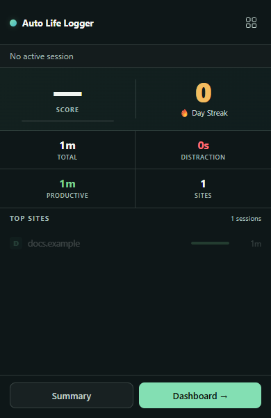

# Auto Life Logger

Review local browsing activity, daily/weekly charts, focus scores, achievements and optional distraction interventions. Export a versioned backup and merge session history from current or older backups.

[Repository](https://github.com/flegardev/Auto-life-logger)

## Release status

Candidate **2.2.0**; previous version **2.1.1** is confirmed in repository history; its currently published package has not been independently retrieved. Upload/submission/publication have not occurred. See [release notes](CHANGELOG.md).

## Development

Use Node.js 24 and npm.

```sh
npm ci
npm run validate
npx playwright install chromium
npm run test:extension
npm run package
```

`npm run validate` runs static manifest checks, Node regression tests, a real unpacked Chromium extension test, and the responsive UI suite. For local system Chrome UI tests set `PW_CHANNEL=chrome`; `EXTENSION_CHROMIUM` can select a Chromium executable for unpacked tests.

## Load unpacked

Choose the repository root in Chrome → Extensions → Developer mode → Load unpacked. Test with a separate profile. Production upgrades must go to the existing Store item; a different unpacked path can have a different extension ID.

## Architecture and data

MV3 background worker owns session lifecycle, analytics and message authorization. StorageQueue orders writes and atomic session/history updates; a generation barrier prevents post-deletion stale writes. Stable session IDs deduplicate checkpoints, live totals and finalized sessions. All pages and charts run locally.

## Privacy and permissions

Existing runtime permissions are unchanged. No analytics backend or remote executable code is added. See [privacy policy](PRIVACY.md). Exports contain private local records; share them only intentionally.

## Limitations

Classification follows editable domain lists, not a measurement of work quality. Minute checkpoints reduce service-worker data loss; up to one minute can remain unrecorded after abrupt termination. Backup restore merges eligible sessions and leaves existing settings/progress intact; derived scores can be regenerated. The published listing identity still needs independent confirmation.

## Verification

Automated tests cover actual extension registration, real Chrome storage, legacy-shaped records, restart persistence, user controls and error states. UI fixtures use synthetic, visibly identified sample records. They do not represent the developer’s browsing activity or real car offers. Full live-site playback and all marketplace variants remain manual release checks. Store review/publication are separate from green CI.

## Screenshots

Test fixtures only; these screenshots do not represent real user activity.





## Flagship redesign candidate 2.3.0

Understand your browsing. Keep your history private. Calm light dashboard and popup; seven-day review; transparent productive-time goal; category explanation; quiet onboarding; improved chart contrast; overlapping category flags no longer double-count in overview.

[Product and release limits](docs/flagship/PRODUCT.md) · [Research](docs/flagship/RESEARCH.md) · [Store material draft](docs/flagship/STORE_MATERIALS.md). This candidate has not been submitted or published.
